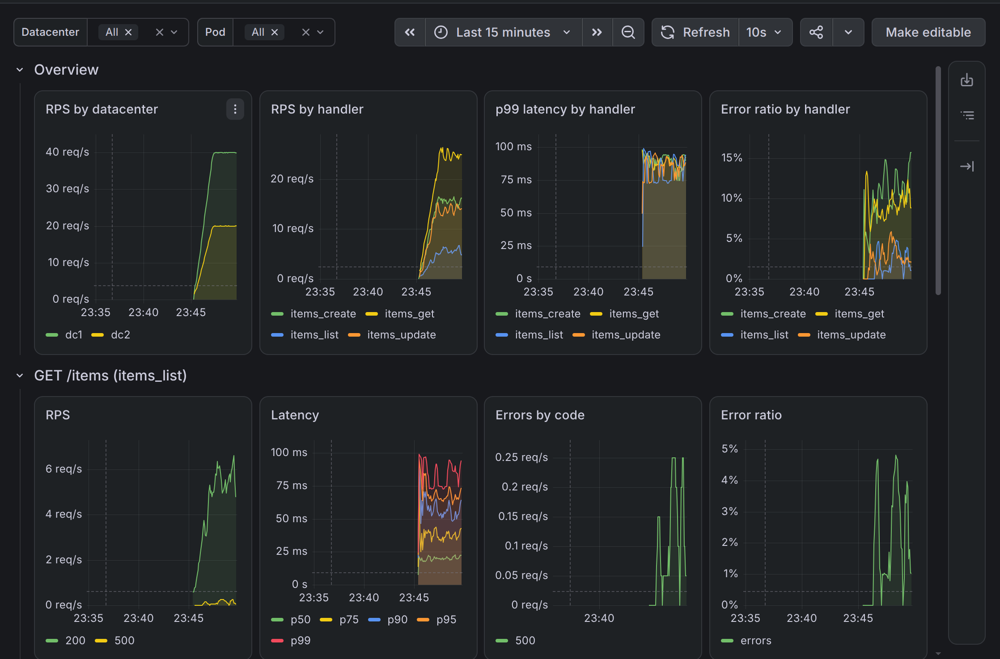

# DDIA HW-1

CRUD-сервис на Go с метриками ручек, VictoriaMetrics, Grafana, генератором дашборды и нагрузчиком.

## Запуск

```sh
make secrets
docker compose up --build
```

`make secrets` один раз генерирует пароль администратора Grafana в
`secrets/grafana_admin_password` (файл не хранится в git). Без него `docker compose up` не запустится.

После запуска `dashgen` получает список ручек у приложения и создаёт дашборду, а `loadgen` за 2 минуты
разгоняет нагрузку до 60 RPS с долей ошибок 4xx/5xx.

## Адреса

- дашборда: http://localhost:3000/d/items-service, логин `admin`, пароль из `secrets/grafana_admin_password`
- приложение: http://localhost:8081, :8082, :8083 (три пода: dc1/pod-1, dc1/pod-2, dc2/pod-1)
- VictoriaMetrics: http://localhost:8428

## Дашборда под нагрузкой


